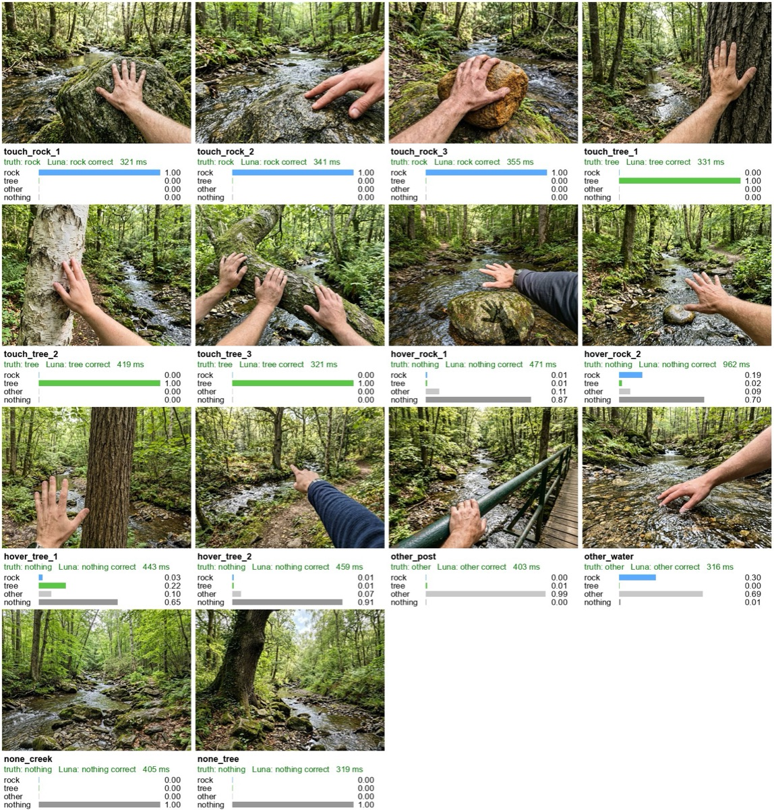

# Shoaling With Kin

A HoloKit app for the creek: touch a stone or a tree, and the shoal of fish around you makes camp
with it. What your hand touches is decided several times a second by OpenRouter's
**GPT-6 Luna Decisions** (`openai/gpt-6-luna-decisions`), which returns a probability for each kin.

- **Live probabilities** — p(rock), p(tree), p(other), p(nothing) as bars (screen in Mono, floating
  bars in Stereo), with latency, answer rate, cost so far, and the exact frame Luna saw.
- **Leaning** — as a kin's probability rises, the shoal drifts toward your hand.
- **Making camp** — on a match, that kin's music starts at the touch point; with a **rock** the
  fish swirl in and slip into the stone, with a **tree** they spiral up the trunk into the canopy.
  Let go and they swim back out around you.

Status: builds, 22 EditMode tests pass, installed on a device; first on-device run pending.
Detection measured on a 22-image test set: 44/44 at 385 ms median — see
[`docs/luna-decisions-findings.md`](docs/luna-decisions-findings.md).



## Layout

```
app/                                   Unity 6000.3.24f1, Built-in RP, iOS
  Assets/ShoalingWithKin/
    Core/                              DecisionsProtocol (request/response), KinMatcher (hysteresis) — no Unity XR deps
    Runtime/                           CameraFrameSampler, LunaDecisionsClient, TouchKinDetector, KinChoreographer, KinHud
      Shoal/                           FishShoal (boids, GPU-instanced), FishMesh
      Audio/                           KinSoundscape, ProceduralMusic (stone drone, leaf chimes)
    Shaders/Fish.shader                instanced, tail wiggle, bright for see-through optics
    Editor/ShoalingWithKinSetup.cs     batchmode scene + player settings + key file + iOS build
    Tests/EditMode/                    22 tests (matcher, protocol)
tools/bench_touch.py                   accuracy/latency benchmark with the app's exact request
tools/results_sheet.py                 annotated contact sheet from a benchmark run
tools/testset/                         14 generated first-person test images + prompts
docs/luna-decisions-findings.md        API format, accuracy, latency, cost, limits
plan/task_plan.md                      decisions and progress
```

## Build and run

Needs: Unity 6000.3.24f1, Xcode, the local HoloKit SDK checkout (pinned in
`app/Packages/manifest.json` as `git+file:///…/holokit-unity-sdk#7ef2463`), an iPhone with LiDAR.

```sh
export OPENROUTER_API_KEY=…            # use a dedicated, credit-limited key: it ships in the app
UNITY=/Applications/Unity/6000.3.24f1/Unity.app/Contents/MacOS/Unity
cd app
# 1. Scene, player settings, key -> Assets/StreamingAssets (gitignored). Exits by itself.
$UNITY -batchmode -nographics -projectPath . -buildTarget iOS -executeMethod ShoalingWithKinSetup.Setup -logFile -
# 2. Tests
$UNITY -batchmode -nographics -projectPath . -buildTarget iOS -runTests -testPlatform EditMode -testResults Logs/editmode-results.xml
# 3. Xcode project, then build, install, launch
$UNITY -batchmode -nographics -projectPath . -buildTarget iOS -executeMethod ShoalingWithKinSetup.BuildIOS -quit -logFile -
xcodebuild -project Builds/iOS/Unity-iPhone.xcodeproj -scheme Unity-iPhone -configuration Release \
  -destination generic/platform=iOS -derivedDataPath Builds/DerivedData -allowProvisioningUpdates build
xcrun devicectl device install app --device <UDID> Builds/DerivedData/Build/Products/Release-iphoneos/ShoalingWithKin.app
xcrun devicectl device process launch --console --device <UDID> io.holokit.shoalingwithkin
```

The same steps are in the Editor menu **Shoaling With Kin**.

## Using it

1. Opens in Mono (screen AR, landscape). Touch a rock, hover over it, touch a tree: watch the bars
   and the "what Luna sees" preview. **Pause Luna** stops requests (and ends any match).
2. Tap **Stereo** and put the phone in HoloKit. Bars float below your gaze; **TRIGGER** hides them.
   The stereo info band shows the match, p(rock), p(tree) and latency.

## Tuning (Inspector on *Shoaling With Kin*)

| Component | Field | Default | Why |
|---|---|---|---|
| TouchKinDetector | Kin | rock (Enter), tree (Climb) | add kin (e.g. water, moss): id + description + colour + gesture + music |
| | Frame Width | 512 | 256 misreads hovering; 768 is +100 ms |
| | Min Interval / Max In Flight | 0.25 s / 2 | ~3–4 answers/s |
| | Matching | enter 0.6 ×1, exit 0.35 ×2 | from the test-set distributions |
| | Match Timeout | 2 s | ends a match when answers stop (no network) |
| FishShoal | Count, Orbit Radius, Climb Height … | 96, 1.3 m, 1.4 m | |
| KinSoundscape | Spatial | 0.75 | music comes from the touch point |

Assign a Music clip to a kin to replace its procedural voice.

## Known limits

- The OpenRouter key is inside the app bundle. Keep the key credit-limited; a relay is the fix for
  anything beyond personal devices.
- Frames are sent whole (no crop around the hand). The touch point comes from HoloKit hand tracking
  (LiDAR); without a fresh hand pose it falls back to 0.55 m ahead, 25° below the gaze.
- Accuracy is measured on generated and stock images only, not yet on real headset frames.
